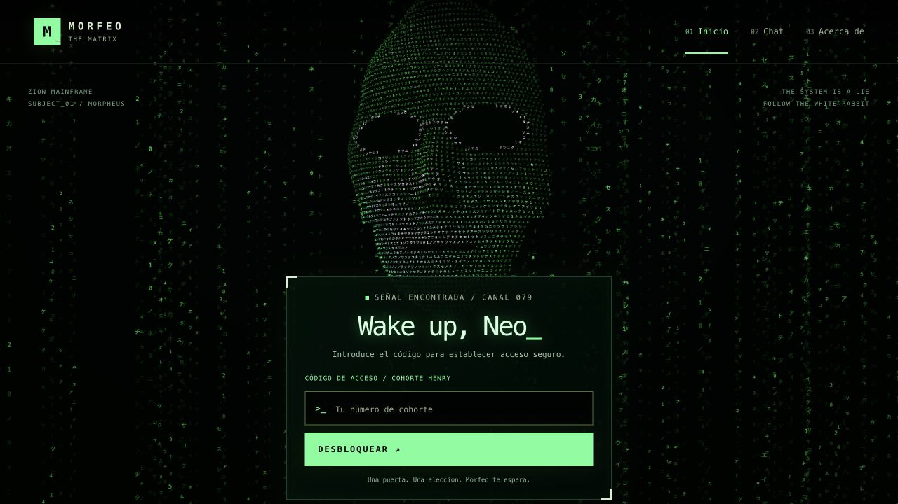
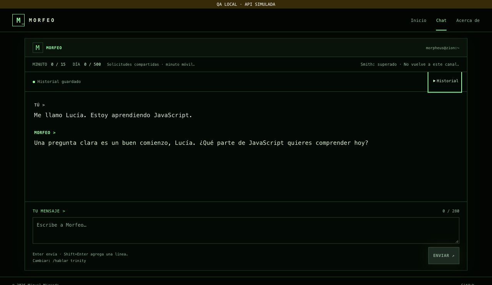
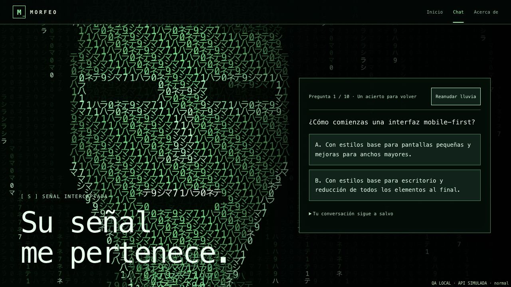

# Chat con Morfeo

Creé esta aplicación para conversar en español con interpretaciones de Morfeo, el Oráculo y Trinity de *The Matrix (1999)*. Es mi Proyecto Integrador del Módulo 3 de Full Stack de Henry; lo desarrollé con asistencia de Codex.

**[Abrir la aplicación](https://chat-morfeo-m3.vercel.app/home)** · **[Ver el repositorio](https://github.com/MiguelMirandaV/chat-morfeo-m3)**

> Esta rama incorpora el cuestionario de Smith. La publicación de esta iteración está pendiente; el dominio público y las capturas conservan la versión anterior.

## Código de acceso

**El código para abrir el chat es `79`.** Introdúcelo en el campo de cohorte de Henry y pulsa **Desbloquear**.

Uso este código como una puerta temática compartida. No representa una cuenta personal ni identifica a cada visitante.



## Mi propuesta

Elegí a Morfeo por su voz serena y reflexiva, sus preguntas sobre la libertad y su forma de acompañar el aprendizaje. Cada personaje tiene instrucciones propias de voz y conserva su conversación independiente. Las respuestas aprovechan el contexto y distinguen el universo ficticio de Matrix del mundo real.

Diseñé la interfaz como una terminal de Zion. Construí una entrada de pantalla completa: lluvia volumétrica y un rostro procedural en 3D formado por caracteres, con una cámara que entra por su boca para abrir el chat. Incluí pausa, opción de omitir la transición, navegación con teclado, movimiento reducido y una alternativa en Canvas 2D cuando WebGL no está disponible. [Explico la escena y sus límites](docs/home-3d.md).

## Qué puedes hacer

- Navegar por **Inicio**, **Chat** y **Acerca de** sin recargar la página; usar Atrás y Adelante.
- Elegir a **Morfeo, el Oráculo o Trinity** después de desbloquear el canal y solicitar un cambio desde la conversación, con confirmación.
- Conversar mediante Gemini, enviando el historial completo del personaje elegido en cada petición. Los borradores y errores también se mantienen separados.
- Enviar con **Enter** o el botón; agregar líneas con **Shift+Enter**.
- Escribir hasta **280 caracteres visibles**, incluidos espacios, saltos y emojis compuestos. El texto pegado que excede el límite se conserva para corregirlo.
- Conversar en una terminal de una columna, con emblemas cifrados para los tres personajes y contadores breves.
- Ver el estado de escritura y recuperar el borrador si una respuesta falla.
- Recuperar conversaciones y borradores al recargar; borrar una conversación o todas, con confirmación.
- Resolver cambios detectados desde otra pestaña antes de sobrescribir un historial.
- Consultar las solicitudes compartidas de la app: **15 en una ventana móvil de 60 segundos y 500 al día**.
- Resolver un reto de **Smith una sola vez por personaje**, tras tres intercambios completos: diez preguntas del M3, dos opciones y un acierto para recuperar la conversación.
- Recuperar la pregunta pendiente o el reto superado al recargar; vivir la toma de pantalla de Smith, con rostro de caracteres a gran escala, pausa y movimiento reducido.

Guardo historiales y borradores por personaje en localStorage; se recuperan al volver al mismo sitio. El indicador muestra si el navegador pudo guardarlos. Para cambiar, escribe **«Quiero hablar con Trinity»** o **`/hablar trinity`** y confirma. Acerca de presenta las tres voces con retratos vectoriales originales. [Explico el funcionamiento y los límites](docs/alcance.md).

## Cómo usar la aplicación

1. Abre la aplicación e introduce **79**.
2. Entra al canal; puedes omitir la transición con el botón o Escape.
3. Elige a **Morfeo, el Oráculo o Trinity**, escribe una pregunta y presiona **Enter** o pulsa **Enviar**. Usa **Shift+Enter** para agregar una línea.
4. Espera la respuesta. Ante un fallo, revisa el mensaje de estado y reintenta con el borrador conservado.
5. Puedes navegar o recargar y recuperar lo guardado en ese mismo navegador y sitio. Un envío interrumpido vuelve como borrador; no se reenvía automáticamente.
6. Después de tres intercambios completos con un personaje, responde una pregunta de Smith. Un acierto recupera tu conversación y evita nuevas interrupciones para ese personaje. Si fallas, aparece la siguiente; después de la décima vuelve a la primera. El cuestionario es local y no consume solicitudes de IA.
7. Abre **Historial**, elige **Borrar esta conversación** o **Borrar todos los historiales** y confirma si quieres eliminarlos. El borrado conserva el progreso de Smith y las cuotas.

Envío las preguntas a Gemini a través de mi función de servidor. No escribas contraseñas ni claves en la conversación.

## Tecnologías y estructura

Utilicé HTML, CSS y JavaScript con módulos ES para la SPA, una función Node en Vercel como backend, el SDK `@google/genai` para Gemini, Redis de Upstash para los contadores, Three.js para el rostro y la lluvia 3D, y Vitest para las pruebas.

```text
api/functions.js       Acceso, cuotas, validación, tres prompts y adaptador Gemini
src/index.html         Documento inicial
src/app.js             Vistas, routing, foco y transición
src/matrix-scene.js    Rostro procedural, lluvia 3D, fallback y limpieza
scripts/prepare-assets.js Copia local de módulos Three.js y licencia
scripts/evaluate-characters.js Evaluación real optativa con control de cuota
src/chat.js            Conversaciones separadas, peticiones HTTP y render del chat
src/smith-story.js     Progreso de Smith por personaje y persistencia independiente
src/smith-questions.js Diez preguntas educativas y opciones del reto local
src/smith-scene.js     Rostro de caracteres, lluvia y pausa de Smith
src/chat-controls.js   Peticiones de cambio y reglas del teclado
src/characters.js      Identificadores y metadatos públicos de personajes
src/history-storage.js Validación, guardado, restauración y conflictos de localStorage
src/utils.js           Conteo y validación de caracteres
src/styles.css         Estilos responsive y estados visuales
src/assets/            Retratos de la interfaz
tests/                 Pruebas unitarias y contratos con mocks
docs/                  Arquitectura, decisiones, verificaciones y capturas
.env.example           Variables necesarias sin credenciales reales
.vercelignore          Exclusión de archivos privados en la subida
vercel.json            Función, estáticos y fallback de rutas SPA
```

[Explico el flujo de una petición y las responsabilidades de cada archivo](docs/arquitectura.md).

[Evalué las tres voces con Gemini real](docs/evaluacion-personajes.md): recordaron los datos de sus conversaciones y revisé los límites de cada personaje. La evaluación incluye la corrección de identidad del Oráculo y sus resultados completos.

## Ejecutar en tu equipo

### Requisitos

Utilizo **Node.js 24.x**, npm, Git y Vercel CLI local al proyecto. Necesitas una cuenta de Vercel, una clave de Google AI Studio con acceso al modelo configurado y las credenciales REST de Redis para compartir contadores.

### Instalar

En una carpeta nueva:

```bash
git clone https://github.com/MiguelMirandaV/chat-morfeo-m3.git
cd chat-morfeo-m3
npm ci
cp -n .env.example .env
```

Abre la carpeta en VS Code y completa `.env`. Si ya existe, conserva sus valores.

| Variable de servidor | Contenido |
| --- | --- |
| `GEMINI_API_KEY` | Clave privada de Google AI Studio. |
| `GEMINI_MODEL` | `gemini-3.5-flash-lite`. |
| `AUTH_SESSION_SECRET` | Secreto aleatorio privado de al menos 32 caracteres. |
| `UPSTASH_REDIS_REST_URL` | URL REST HTTPS de la base Upstash. |
| `UPSTASH_REDIS_REST_TOKEN` | Token REST privado con escritura. |
| `QUOTA_DRIVER` | `local` permite un archivo privado únicamente en desarrollo sin Redis. |

Para una instalación propia, genera un secreto nuevo con Node y guárdalo en tu `.env`: `node -e "console.log(require('node:crypto').randomBytes(32).toString('hex'))"`. Conserva un secreto existente si quieres mantener válidas sus sesiones. No subas el archivo a Git ni compartas sus valores.

### Iniciar

```bash
npm run vercel:login
npm run vercel:whoami
npm exec -- vercel link
npm start
```

Al vincular una copia nueva, selecciona el proyecto correspondiente de tu cuenta. Mi proyecto existente se llama `chat-morfeo-m3`.

Abre [http://127.0.0.1:3000/home](http://127.0.0.1:3000/home) e introduce **79**. `npm start` prepara los módulos gráficos con `npm run build` y ejecuta Vercel Dev; Ctrl+C detiene esa instancia. Reinicia después de cambiar `.env` y mantén el mismo host durante la sesión para conservar la cookie.

Necesito Vercel Dev para ejecutar también la función; un servidor estático como Live Server solo sirve el frontend. Mantengo `.env.local`, gestionado por Vercel, fuera de Git y sin editar manualmente.

## Ejecutar las pruebas

```bash
npm test
npm run test:watch
```

Incluí **275 pruebas en ocho archivos** para validar caracteres, navegación, historiales separados, identidad, estados, errores, transporte, acceso, cuotas, cuestionario de Smith y contratos de Gemini. Uso mocks para que la suite no consuma Gemini ni Redis reales y restauro el entorno entre pruebas.

[Personajes y contrato](docs/personajes.md) · [Detalle de las pruebas](docs/pruebas-unitarias.md) · [Comprobaciones y límites](docs/verificacion-iteracion-3.md).

## Acceso, datos y cuotas

Guardo conversaciones y borradores en texto en localStorage bajo `morfeo.conversations.v1`. El progreso por personaje y la pregunta pendiente usan `morfeo.smith-story.v2`. La migración estrena contadores en cero y conserva los historiales previos y la clave antigua. Borrar las conversaciones conserva los retos superados o pendientes, las claves ajenas y las cuotas Redis. [Detalles del guardado y sus límites](docs/persistencia.md).

Mantengo la API key y los tres prompts en el servidor. El navegador se comunica mediante `POST /api/functions`; envío códigos de error controlados y muestro mensajes con `textContent`.

Valido el acceso con una cookie firmada, HttpOnly y SameSite=Strict, con expiración de ocho horas y Secure bajo HTTPS. Aplico el límite de caracteres tanto en cliente como en servidor.

Redis guarda cantidades y tiempos de solicitudes, nunca mensajes. Reservo cuota antes de llamar a Gemini; una respuesta fallida también puede consumirla. Si configuras ambas credenciales Redis, tienen prioridad sobre el archivo local. En Vercel exijo Redis compartido.

El contador mide solicitudes de esta app; no toda la actividad externa de Google ni sus tokens. El día reinicia a medianoche del Pacífico. La espera indicada no garantiza que una cuota externa ya esté disponible.

El cuerpo de conversación admite hasta 64 KiB, sin recortar el historial. Uso un intento por generación, hasta 30 s para Gemini, 40 s para el cliente y 60 s como máximo de función. [Configuración de Redis](docs/redis.md).

## Publicar en Vercel

Conecto el repositorio con Vercel y publico desde `main`. Mantengo la raíz del repositorio como Root Directory, `src` como salida estática, Node 24 y `npm ci` como instalación.

Configura en Production y Preview las cinco variables de servidor de la tabla, excluyendo `QUOTA_DRIVER`. Uso la misma base Redis cuando ambos entornos consumen el mismo proyecto de Gemini. Cada cambio de variables requiere un despliegue nuevo.

[Guía de despliegue](docs/despliegue.md) · [Publicación de esta iteración](docs/publicacion-iteracion-3.md).

## Capturas

| Terminal de conversación | Intervención de Smith |
| --- | --- |
|  |  |

Estas dos capturas proceden de la revisión local con API simulada. La imagen de Inicio conserva el diseño publicado anterior, sin cambios en esta iteración. Distingo las comprobaciones locales de la [verificación del despliegue](docs/publicacion-iteracion-3.md) y de la [evaluación real de voces](docs/evaluacion-personajes.md).

## Límites y mantenimiento

- Gemini puede equivocarse, repetirse o tardar; los prompts y las pruebas no garantizan todas las respuestas futuras.
- El código 79 es compartido. No ofrece identidad individual ni sincronización entre dispositivos.
- Los rostros son interpretaciones procedurales y vectoriales; no busco una reproducción fotorrealista de los actores. El fallback de Home usa una escena 2D.
- Probé tamaños concretos y un navegador; no certifico todos los dispositivos ni lectores de pantalla.
- Fijé las dependencias mediante el lockfile. Los resultados de la auditoría anterior quedan identificados por versión y fecha en [su registro histórico](docs/auditoria-final.md); no representan un análisis nuevo de vulnerabilidades.

## Documentación y asistencia de IA

Desarrollé este proyecto con asistencia de Codex para el código, los retratos, las pruebas y la documentación. Definí el personaje, la dirección visual y los requisitos, y configuré mis cuentas y credenciales. En [cómo utilicé la IA](docs/uso-ia.md) explico mi proceso con ejemplos de prompts, respuestas y decisiones.

- [Índice de documentación](docs/README.md).
- [Alcance funcional](docs/alcance.md) y [mapa de objetivos y rúbrica](docs/entrega.md).
- [Verificación y límites](docs/verificacion-iteracion-3.md).
- [Personajes y evaluación real](docs/evaluacion-personajes.md).
- [Arquitectura](docs/arquitectura.md), [historiales](docs/persistencia.md) y [Smith](docs/smith.md).
- [Publicación](docs/publicacion-iteracion-3.md) y [guía de despliegue](docs/despliegue.md).

© 2026 Miguel Miranda. Mi interpretación de Matrix es un proyecto académico; no es un producto oficial de la franquicia.
