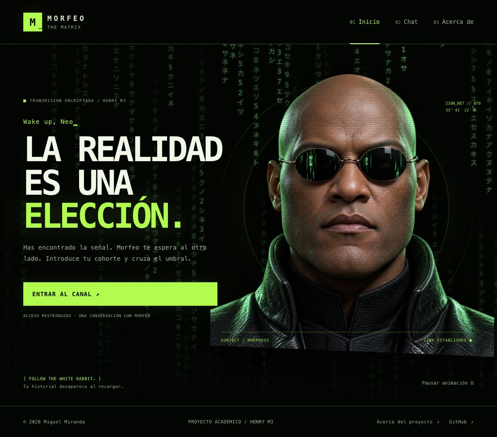
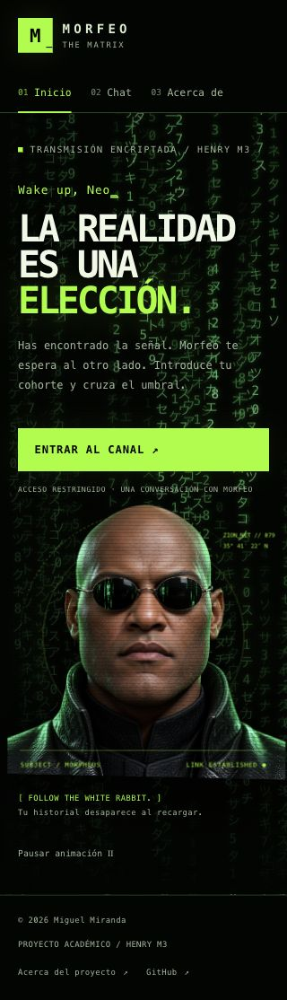
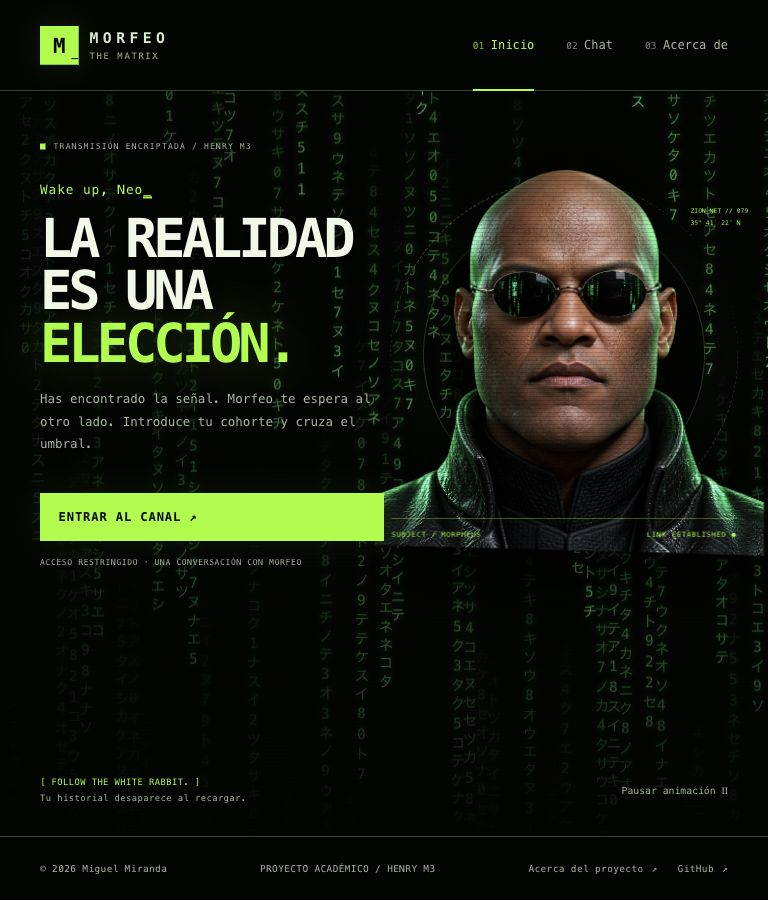
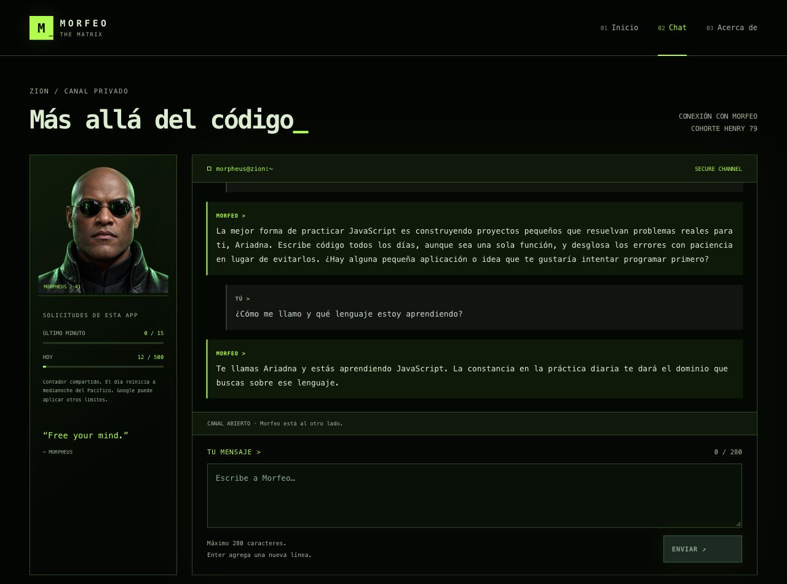

# Chat con Morfeo

Creé esta aplicación para conversar en español con una interpretación de Morfeo de *The Matrix (1999)*. Es mi Proyecto Integrador del Módulo 3 de Full Stack de Henry; lo desarrollé con asistencia de Codex.

**[Abrir la aplicación](https://chat-morfeo-m3.vercel.app/home)** · **[Ver el repositorio](https://github.com/MiguelMirandaV/chat-morfeo-m3)**

## Código de acceso

**El código para abrir el chat es `79`.** Introdúcelo en el campo de cohorte de Henry y pulsa **Desbloquear**.

Uso este código como una puerta temática compartida. No representa una cuenta personal ni identifica a cada visitante.



## Mi propuesta

Elegí a Morfeo por su voz serena y reflexiva, sus preguntas sobre la libertad y su forma de acompañar el aprendizaje. Mi interpretación responde con frases breves, aprovecha el contexto de la conversación y distingue el universo ficticio de Matrix del mundo real.

Diseñé la interfaz como una terminal de Zion: tonos verdes, lluvia de caracteres, retrato CGI y una transición hacia el chat a través de la boca de Morfeo. Incluí pausa, opción de omitir la transición, navegación con teclado y reglas de movimiento reducido.

## Qué puedes hacer

- Navegar por **Inicio**, **Chat** y **Acerca de** sin recargar la página; usar Atrás y Adelante.
- Conversar con Morfeo mediante Gemini, enviando el historial completo en cada petición.
- Escribir hasta **280 caracteres visibles**, incluidos espacios, saltos y emojis compuestos. El texto pegado que excede el límite se conserva para corregirlo.
- Ver el estado de escritura y recuperar el borrador si una respuesta falla.
- Consultar las solicitudes compartidas de la app: **15 en una ventana móvil de 60 segundos y 500 al día**.
- Ver la intervención visual de Smith cuando el servidor rechaza una solicitud por cuota.

En esta versión, uso el botón **Enviar**; Enter agrega una línea. Conservo la conversación en memoria al navegar y la borro al recargar. La ampliación que estoy desarrollando tiene sus reglas en [el alcance de la iteración](docs/iteracion-2.md).

## Cómo usar la aplicación

1. Abre la aplicación e introduce **79**.
2. Entra al canal; puedes omitir la transición con el botón o Escape.
3. Escribe una pregunta y pulsa **Enviar**.
4. Espera la respuesta. Ante un fallo, revisa el mensaje de estado y reintenta con el borrador conservado.
5. Puedes ir a Acerca de y volver sin perder la conversación. Recargar inicia una conversación vacía.

Envío las preguntas a Gemini a través de mi función de servidor. No escribas contraseñas ni claves en la conversación.

## Tecnologías y estructura

Utilicé HTML, CSS y JavaScript con módulos ES para la SPA, una función Node en Vercel como backend, el SDK `@google/genai` para Gemini, Redis de Upstash para los contadores y Vitest para las pruebas.

```text
api/functions.js       Acceso, cuotas, validación, prompt y adaptador Gemini
src/index.html         Documento inicial
src/app.js             Vistas, routing, lluvia y transición
src/chat.js            Estado, peticiones HTTP y render del chat
src/utils.js           Conteo y validación de caracteres
src/styles.css         Estilos responsive y estados visuales
src/assets/            Retratos de la interfaz
tests/                 Pruebas unitarias y contratos con mocks
docs/                  Arquitectura, decisiones, verificaciones y capturas
.env.example           Variables necesarias sin credenciales reales
.vercelignore          Exclusión de archivos privados en la subida
vercel.json            Función, estáticos y fallback de rutas SPA
```

[Explico el flujo de una petición y las responsabilidades de cada archivo](docs/arquitectura.md).

## Ejecutar en tu equipo

### Requisitos

Utilizo **Node.js 24.x**, npm, Git y Vercel CLI local al proyecto. Necesitas una cuenta de Vercel, una clave de Google AI Studio con acceso al modelo configurado y las credenciales REST de Redis para compartir contadores.

### Instalar

En una carpeta nueva:

```bash
git clone https://github.com/MiguelMirandaV/chat-morfeo-m3.git
cd chat-morfeo-m3
npm ci
cp -n .env.example .env
```

Abre la carpeta en VS Code y completa `.env`. Si ya existe, conserva sus valores.

| Variable de servidor | Contenido |
| --- | --- |
| `GEMINI_API_KEY` | Clave privada de Google AI Studio. |
| `GEMINI_MODEL` | `gemini-3.5-flash-lite`. |
| `AUTH_SESSION_SECRET` | Secreto aleatorio privado de al menos 32 caracteres. |
| `UPSTASH_REDIS_REST_URL` | URL REST HTTPS de la base Upstash. |
| `UPSTASH_REDIS_REST_TOKEN` | Token REST privado con escritura. |
| `QUOTA_DRIVER` | `local` permite un archivo privado únicamente en desarrollo sin Redis. |

Para una instalación propia, genera un secreto nuevo con Node y guárdalo en tu `.env`: `node -e "console.log(require('node:crypto').randomBytes(32).toString('hex'))"`. Conserva un secreto existente si quieres mantener válidas sus sesiones. No subas el archivo a Git ni compartas sus valores.

### Iniciar

```bash
npm run vercel:login
npm run vercel:whoami
npm exec -- vercel link
npm start
```

Al vincular una copia nueva, selecciona el proyecto correspondiente de tu cuenta. Mi proyecto existente se llama `chat-morfeo-m3`.

Abre [http://127.0.0.1:3000/home](http://127.0.0.1:3000/home) e introduce **79**. `npm start` ejecuta Vercel Dev; Ctrl+C detiene esa instancia. Reinicia después de cambiar `.env` y mantén el mismo host durante la sesión para conservar la cookie.

Necesito Vercel Dev para ejecutar también la función; un servidor estático como Live Server solo sirve el frontend. Mantengo `.env.local`, gestionado por Vercel, fuera de Git y sin editar manualmente.

## Ejecutar las pruebas

```bash
npm test
npm run test:watch
```

Incluí **130 pruebas en tres archivos** para validar caracteres, navegación, historial, estados, errores, transporte, acceso, cuotas y respuestas de Gemini. Uso mocks para que la suite no consuma Gemini ni Redis reales y restauro el entorno entre pruebas.

[Detalle de las pruebas](docs/pruebas-unitarias.md) · [Comprobaciones y límites](docs/pruebas.md).

## Acceso, datos y cuotas

Mantengo la API key y el prompt en el servidor. El navegador se comunica mediante `POST /api/functions`; envío códigos de error controlados y muestro mensajes con `textContent`.

Valido el acceso con una cookie firmada, HttpOnly y SameSite=Strict, con expiración de ocho horas y Secure bajo HTTPS. Aplico el límite de caracteres tanto en cliente como en servidor.

Redis guarda cantidades y tiempos de solicitudes, nunca mensajes. Reservo cuota antes de llamar a Gemini; una respuesta fallida también puede consumirla. Si configuras ambas credenciales Redis, tienen prioridad sobre el archivo local. En Vercel exijo Redis compartido.

El contador mide solicitudes de esta app; no toda la actividad externa de Google ni sus tokens. El día reinicia a medianoche del Pacífico. La espera indicada no garantiza que una cuota externa ya esté disponible.

El cuerpo de conversación admite hasta 64 KiB, sin recortar el historial. Uso un intento por generación, hasta 30 s para Gemini, 40 s para el cliente y 60 s como máximo de función. [Configuración de Redis](docs/redis.md).

## Publicar en Vercel

Conecto el repositorio con Vercel y publico desde `main`. Mantengo la raíz del repositorio como Root Directory, `src` como salida estática, Node 24 y `npm ci` como instalación.

Configura en Production y Preview las cinco variables de servidor de la tabla, excluyendo `QUOTA_DRIVER`. Uso la misma base Redis cuando ambos entornos consumen el mismo proyecto de Gemini. Cada cambio de variables requiere un despliegue nuevo.

[Guía de despliegue](docs/despliegue.md) · [Evidencia de producción](docs/produccion.md).

## Capturas

| Móvil | Tablet | Escritorio |
| --- | --- | --- |
|  |  |  |



## Límites y mantenimiento

- Gemini puede equivocarse, repetirse o tardar; mi prompt y las pruebas no garantizan todas las respuestas futuras.
- El código 79 es compartido. No ofrece identidad individual ni sincronización entre dispositivos.
- Uso un retrato CGI prerenderizado animado con CSS en la versión publicada.
- Probé tamaños concretos y un navegador; no certifico todos los dispositivos ni lectores de pantalla.
- Registré 33 avisos de herramientas de desarrollo, sin críticos, y 0 avisos de dependencias de producción en la auditoría. Fijé el parche `tar@7.5.22` mediante overrides. [Alcance del examen](docs/auditoria-final.md).

## Documentación y asistencia de IA

Desarrollé este proyecto con asistencia de Codex para el código, los retratos, las pruebas y la documentación. Definí el personaje, la dirección visual y los requisitos, y configuré mis cuentas y credenciales. Registro las solicitudes, decisiones y comprobaciones en [uso de IA](docs/uso-ia.md).

- [Alcance de la versión entregada](docs/alcance.md).
- [Alcance aprobado de la siguiente iteración](docs/iteracion-2.md).
- [Evaluación del personaje](docs/evaluacion-prompt.md).
- [Revisión de experiencia](docs/revision-ux.md).
- [Auditoría de entrega](docs/auditoria-final.md).

© 2026 Miguel Miranda. Mi interpretación de Matrix es un proyecto académico; no es un producto oficial de la franquicia.
