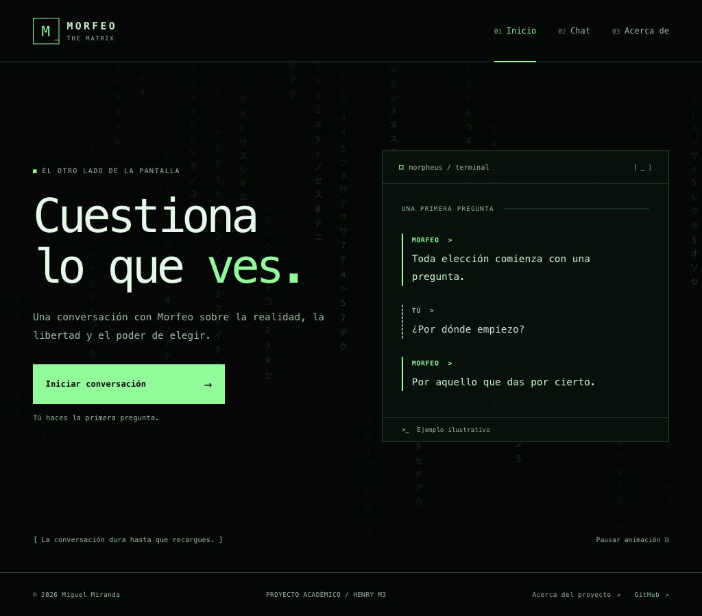

# Chat con Morfeo

Proyecto Integrador del Módulo 3 de Full Stack de Henry. Aplicación en desarrollo para conversar en español con Morfeo de Matrix, con estética de terminal.

## Estado del proyecto

Los pasos 1–4 están completos: definición, entorno, interfaz responsive y routing SPA con History API. Inicio, Chat y Acerca de se renderizan sin recargar, con Atrás/Adelante, carga directa, normalización de rutas y vista interna de no encontrado. Home incluye una cascada de caracteres verdes con pausa. El contador de 280 caracteres está funcionando. Pasan 17 tests unitarios entre conteo y routing. El proyecto está vinculado a GitHub y al espacio Hobby de Vercel de Miguel.

El chat permite revisar el campo de escritura y su contador, pero el envío está deshabilitado hasta desarrollar la conversación en memoria en el paso 5. Gemini no está integrado todavía. La URL de entrega se documentará después de validar la aplicación completa.

## Alcance acordado

- Vistas SPA: `/home`, `/chat` y `/about`, usando History API.
- HTML, CSS mobile-first y JavaScript con módulos ES.
- Un único personaje: Morfeo, con tono sereno, reflexivo y respuestas breves.
- Máximo de 280 caracteres por mensaje del usuario, validado en navegador y servidor.
- Historial en memoria durante la sesión; se pierde al recargar.
- Gemini mediante `api/functions.js`, con API key solo en servidor.
- Cascada decorativa de caracteres verdes únicamente en `/home`, respetando movimiento reducido.
- Indicador estático de escritura, estados de error y scroll automático.
- Tests con Vitest y despliegue en Vercel.

No se incorporan persistencia, varios personajes, timestamps, envío con Enter, copiar respuestas ni cambio de tema. Enter insertará una nueva línea en el textarea.

## Requisitos

- Node.js 24.x y npm.
- Git para control de versiones.
- Cuenta de Vercel para utilizar su CLI y las funciones locales.
- Cuenta de Google AI Studio y una clave de Gemini en la etapa de integración.
- Navegador reciente con soporte para Intl.Segmenter, utilizado para contar caracteres visibles, incluidas tildes y emojis compuestos.

Vitest y Vercel CLI son dependencias de desarrollo del proyecto. Los scripts de npm ejecutan sus versiones locales; no hace falta instalarlas globalmente.

## Instalación

Desde una terminal situada en la raíz del proyecto:

```bash
npm ci
```

Este comando instala las versiones registradas en `package-lock.json`. Para la primera instalación durante la preparación se utiliza `npm install`; las siguientes copias utilizarán `npm ci`.

## Variables de entorno

Cuando se integre Gemini, copia el ejemplo:

```bash
cp .env.example .env
```

Completa `GEMINI_API_KEY` y `GEMINI_MODEL` en el archivo local. La elección del modelo se verificará en AI Studio. `.env` está ignorado por Git y no debe compartirse. La página de preparación actual no consume Gemini ni requiere una clave.

## Desarrollo local

Comprueba la sesión de Vercel:

```bash
npm run vercel:whoami
```

Si no hay sesión, inicia sesión:

```bash
npm run vercel:login
```

Luego ejecuta:

```bash
npm start
```

Abre la URL que muestre la terminal: el comando está configurado para escuchar únicamente en `http://127.0.0.1:3000`. Se utiliza el nombre `chat-morfeo-m3`, la raíz `.` y el preset Other. La configuración está versionada en `vercel.json`: contenido estático desde `src/`, sin compilación ni proceso de desarrollo adicional. El script se llama `start` porque Vercel rechaza que un script llamado `dev` invoque de nuevo `vercel dev`. El fallback entrega index.html para las rutas de vistas, excluyendo /api, /_vercel y rutas con puntos para mantener los archivos y endpoints a cargo del servidor. Detén el servidor con Ctrl+C.

## Tests

Los comandos previstos son:

```bash
npm test
npm run test:watch
```

Actualmente pasan 17 tests en dos archivos:

- `utils.test.js`: cuatro casos de conteo, incluyendo bordes 279/280/281, espacios/saltos de línea, tildes equivalentes y emojis compuestos.
- `app.test.js`: trece casos de rutas, normalización, selección de enlaces, orden pushState/render, destinos repetidos y bloqueo de destinos externos en navigateTo.

Los tests del router importan funciones sin montar un DOM y utilizan mocks para verificar History API y el orden de las llamadas. Se añadirán pruebas de la lógica del chat, transformación de respuestas y errores con fetch mockeado al implementar esas funciones. Las pruebas actuales no verifican una integración Gemini que aún no existe.

## Navegación SPA

`navigateTo` actualiza la URL con pushState y llama al render de inmediato; un único listener popstate refleja Atrás/Adelante sin crear entradas nuevas. La raíz `/` se normaliza a `/home` y las barras finales se corrigen con replaceState. Se mantienen los parámetros y fragmentos.

El router respeta Cmd/Ctrl-click, enlaces externos, target, descargas, protocolos especiales y anclas de la misma página. Al cambiar de vista mueve el foco al contenido y ejecuta la limpieza de la vista anterior. Así, la cascada y sus listeners solo existen en Inicio.

Se comprobó la navegación real mediante un proxy temporal de QA: la carga inicial produjo una descarga de documento HTML; los cambios de vista y Atrás/Adelante no añadieron otra. Cmd+click abrió una nueva pestaña y produjo la segunda descarga esperada. El proxy fue retirado al terminar la comprobación y no forma parte de la aplicación.

Una ruta desconocida muestra la vista de no encontrado con enlace de regreso. Su documento base se entrega con HTTP 200 por ser el fallback de la SPA; el contenido representa la ruta inexistente. Los recursos estáticos inexistentes y /api/functions, que aún no está implementado, siguen devolviendo 404 del servidor.

## Interfaz y comprobaciones responsive

El CSS parte de 320 px, agrega una distribución de tablet a 768 px y dos columnas de Inicio a 1024 px. Se comprobaron las tres vistas en esos tres anchos, sin desbordamiento horizontal. El fondo de Home tiene un control para pausar/reanudar, se detiene al ocultar la pestaña y respeta `prefers-reduced-motion`. Chat y Acerca de no crean la cascada.

La conversación del panel de Inicio es un ejemplo ilustrativo escrito para la maqueta; no procede de una llamada a Gemini.

El footer incluye `© 2026 Miguel Miranda` y un enlace al repositorio en GitHub.



| Vista | Móvil | Tablet | Escritorio |
| --- | --- | --- | --- |
| Inicio | [320 px](docs/capturas/home-320.jpg) | [768 px](docs/capturas/home-768.jpg) | [1024 px](docs/capturas/home-1024.jpg) |
| Chat | [320 px](docs/capturas/chat-320.jpg) | [768 px](docs/capturas/chat-768.jpg) | [1024 px](docs/capturas/chat-1024.jpg) |
| Acerca de | [320 px](docs/capturas/about-320.jpg) | [768 px](docs/capturas/about-768.jpg) | [1024 px](docs/capturas/about-1024.jpg) |

El estado de exceso de caracteres también está [documentado con una captura real](docs/capturas/chat-limite-281.jpg).

El footer actualizado está capturado a [320 px](docs/capturas/home-copyright-320.jpg), [768 px](docs/capturas/home-copyright-768.jpg) y [1024 px](docs/capturas/home-copyright-1024.jpg). La [vista de ruta desconocida](docs/capturas/ruta-desconocida-1024.jpg) también está documentada.

## Organización

```text
api/              Función de Vercel; se implementará en su etapa
src/index.html    Documento inicial
src/styles.css    Estilos
src/app.js        Entrada, vistas y routing
src/chat.js       Estado y lógica del chat
src/utils.js      Validaciones y transformaciones
tests/            Tests unitarios del conteo; se ampliarán con las siguientes funciones
docs/             Alcance, registro de IA, pruebas y capturas
```

La ficha del personaje y los criterios completos están en [docs/alcance.md](docs/alcance.md).

## Despliegue

Se conectará este repositorio a Vercel en la etapa de publicación. Se configurarán las variables del servidor y se verificará tanto la SPA como la función real. La URL productiva y las instrucciones finales se documentarán después de comprobar ese despliegue.

## Evidencias y uso de IA

- [Registro de uso de IA](docs/uso-ia.md)
- [Registro de comprobaciones](docs/pruebas.md)
- Las capturas reales de esta etapa están en `docs/capturas/`.

Miguel definió el personaje, la dirección visual, el máximo de caracteres y aprobó el plan. Codex apoya la planificación, el desarrollo y las verificaciones. Los registros distinguen acciones realizadas de funcionalidades pendientes.
