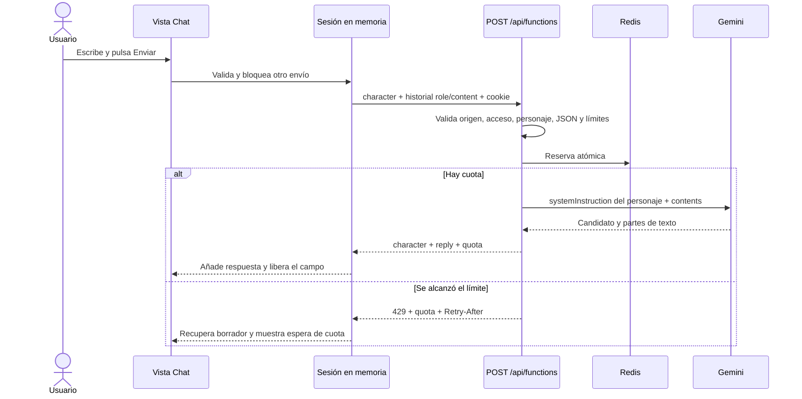

# Arquitectura y conceptos del M3

La estructura conserva `/api`, `/src` y `/tests` de la consigna. No hay framework frontend, compilador de interfaz ni servidor Express. El navegador carga módulos ES; Vercel ejecuta la función Node del backend.

## Flujo de una pregunta

El desbloqueo se hace antes de este recorrido: `{action:"unlock",cohort:"79"}` obtiene una cookie firmada. `{action:"session"}` consulta acceso y cuotas sin reservar una generación. La clave Gemini nunca forma parte del cuerpo enviado por el navegador.

## Responsabilidades

| Archivo | Funciones y trabajo |
| --- | --- |
| `src/app.js` | Vistas, `resolveRoute`, decisiones de navegación, `pushState`/`popstate`, foco y portal; limpia los recursos de la vista anterior. |
| `src/matrix-scene.js` | Geometría procedural, atlas de caracteres, lluvia WebGL, fallback 2D, apertura y cámara; libera recursos al desmontar. |
| `scripts/prepare-assets.js` | Copia los módulos Three.js fijados y su licencia a `src/vendor`, generado e ignorado en Git. |
| `src/chat.js` | `createCharacterSession` coordina tres `createChatSession`, con mensajes/borrador/error separados; `postApi` gestiona fetch, JSON y errores; `mountChat`/`mountAccess` conectan estado y DOM. |
| `src/history-storage.js` | Valida registros versionados, guarda/restaura, protege borradores, coordina conflictos y borrado de la clave propia. |
| `src/smith-story.js` | Valida y guarda el ciclo narrativo en su propia clave, con respuestas locales de Smith y aviso de conflictos. |
| `src/smith-scene.js` | Rostro procedural proyectado y lluvia Canvas; pausa, movimiento reducido, visibilidad y limpieza. |
| `src/chat-controls.js` | Reconoce peticiones directas de cambio, decide Enter/Shift+Enter/composición y coordina el plazo de retorno disponible; no interpreta respuestas del modelo. |
| `src/characters.js` | Identificadores permitidos y metadatos públicos, sin prompts. |
| `src/utils.js` | `countCharacters` con Intl.Segmenter y `getMessageError`; la función backend reutiliza la validación. |
| `api/functions.js` | `createHandler`, acceso firmado, validación del historial, reserva, adaptador Gemini y parseo. Usa dependencias inyectables para ensayar fallos sin red. |
| `src/styles.css` | Base móvil y adaptaciones 768/1024, Flexbox/Grid, estados, foco y movimiento reducido. |
| `tests/` | Casos de lógica y contratos; configuración restaura mocks y bloquea fetch real no sustituido. |
| `vercel.json` | Build de módulos gráficos, estáticos desde `src`; fallback a index para rutas SPA excluyendo API y archivos. |

## Conceptos que debes poder explicar

- **SPA:** cambiar la URL con pushState y renderizar la vista no vuelve a descargar el HTML. Atrás/Adelante dispara popstate. Cargar directamente `/chat` sí requiere que el servidor entregue index.html.
- **Asincronía:** `pending` cambia antes del primer await para impedir envíos simultáneos. try/catch/finally distingue resultado/error y libera la espera. La respuesta puede terminar aunque Chat esté desmontado porque el estado pertenece al módulo.
- **Fetch y JSON:** primero se interpreta HTTP (`response.ok`), después el contrato. El cliente no muestra excepciones internas. Los errores tienen códigos permitidos y textos controlados.
- **Roles:** el navegador envía user/assistant; `toGeminiContents` transforma assistant a model y content a parts. El system prompt lo añade el servidor como systemInstruction, separado del historial.
- **Tokens y longitud:**280 grafemas limita lo escrito por el usuario;1024 tokens limita el presupuesto de salida del modelo. No equivalen a palabras ni garantizan una longitud exacta. La brevedad se instruye y evalúa con ejemplos reales.
- **Temperature:** controla variación en modelos que la admiten; esta configuración omite temperature/top_p/top_k siguiendo la revisión del modelo realizada en el paso 7. No se trasladan parámetros de otro SDK a ciegas.
- **Rate limiting:** Redis reserva antes de llamar al proveedor mediante Lua atómico. Evita que instancias concurrentes admitan el mismo cupo restante. Un fallo posterior mantiene la reserva porque el proveedor pudo procesarlo.
- **Mocking:** permite reproducir desconexiones,503 o 429 sin gastar cuota. Demuestra lógica de recuperación; no demuestra tono de Morfeo ni disponibilidad real de Google.

## Datos y límites de seguridad

| Dato | Dónde vive | Duración / uso |
| --- | --- | --- |
| Ciclo y diálogo local de Smith | Memoria y clave independiente de localStorage | Conserva progreso y personaje de retorno; no se envía a Gemini. |
| Conversación y borrador | Memoria y localStorage del navegador | Persisten al navegar y, si el guardado funciona, al recargar el mismo origen. El historial se envía a la función y a Gemini para generar la respuesta. |
| Cookie de acceso | Navegador, HttpOnly | Token firmado con expiración de 8 horas; Secure en HTTPS, SameSite=Strict. Sin identidad individual. |
| Cantidades y tiempos de solicitudes | Redis compartido, o archivo privado solo en desarrollo sin Redis | Ventana móvil y día del Pacífico, con expiraciones. No guarda mensajes. |
| Claves y secreto de sesión | Entorno del servidor | `.env` local y variables de Vercel, excluidos del código público. |
| Prompts | Constantes del backend | Define el personaje; no contiene claves. No se envía como parte de los assets estáticos. |

La app persiste conversaciones en el navegador; esto es independiente de las políticas de tratamiento de datos del proveedor externo. El código 79 es conocido y compartido, por lo que no debe considerarse una cuenta personal ni protección general contra abuso.

## Cómo recorrer el código en VS Code

1. Lee `src/utils.js`: empieza por la validación más pequeña.
2. Abre `createChatSession` en `src/chat.js`: sigue draft → pending → messages/error.
3. Revisa `postApi` y después `createHandler` en el backend.
4. Sigue `validateHistory` → cuota → `generateGeminiReply` → `parseGeminiReply`.
5. Regresa a `mountChat` para ver cómo se convierte el estado en interfaz.
6. Termina con el router y su limpieza en `src/app.js`. Usa los tests como ejemplos de entradas/resultados, sin ejecutarlos contra servicios reales.

## Selección y conversaciones de personajes

El acceso autenticado muestra la elección inicial. El estado empieza con `character: null`; no admite envíos sin destinatario. Cada personaje tiene un almacén propio en un Map. Al enviar, la sesión captura su identificador y llama al transporte con una copia de su historial. Un envío pendiente bloquea otro envío y un cambio de selección. Los snapshots públicos copian los mensajes para impedir modificaciones externas.

El contrato de generación es `{character, messages}`, con `character` limitado a `morpheus`, `oracle` o `trinity`. La función valida el acceso y el contrato antes de reservar cuota. El prompt correspondiente se obtiene de constantes del servidor; no se acepta una instrucción enviada por el navegador. La respuesta incluye `{character, reply, quota}` y el cliente rechaza una identidad que no coincida. Esta etiqueta comprueba coherencia del contrato; no es una firma criptográfica del contenido.

La separación de historiales se implementa en el cliente; el servidor valida la estructura del historial recibido y no conserva conversaciones. Las cuotas Redis siguen siendo globales entre personajes. El estado se guarda mediante un controlador de localStorage independiente de la vista. La clave contiene selección, mensajes, borradores y marcas de interrupción; los errores transitorios, cuotas y credenciales quedan fuera. [Formato, fallos y coordinación entre pestañas](persistencia.md). La elección inicial abre una voz; los cambios posteriores se solicitan dentro del chat y requieren confirmación.

Los prompts tienen una base compartida de conversación, brevedad y límites de ficción. Morfeo acompaña la reflexión y el aprendizaje; el Oráculo explora elecciones con calidez sin predecir el futuro real; Trinity propone acciones concretas sin fingir haberlas ejecutado. La configuración de Gemini y los tiempos de espera se mantienen.

## Transferencia de canal

El coordinador separa un control de cambio de una pregunta antes de llamar al proveedor. Conserva una intención privada con origen, destino, borrador y revisión. Confirmar limpia únicamente el comando del origen y selecciona el destino en una sola notificación; cancelar conserva el texto. No hay mensajes de control en el contexto Gemini. Las intenciones no se serializan: recargar exige volver a solicitar y confirmar. Una restauración invalida cualquier intención anterior. [Detalle](terminal.md).

## Narrativa independiente de las cuotas

El cierre exitoso de un turno incrementa el contador antes de notificar pending=false. Al tercero se fija el personaje de retorno. Los dos pares de Smith son locales, separados de las conversaciones normales. Al completar 2/2, un botón o un temporizador de 12 segundos restituye el canal y reinicia solo la cadencia narrativa. Historial y ciclo usan claves diferentes; borrar uno no elimina el otro. [Diseño, persistencia y límites](smith.md).
