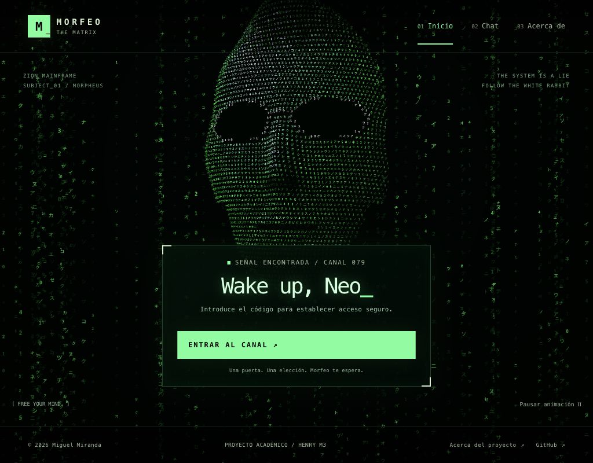

# Inicio: rostro de código y lluvia volumétrica

Construí el prototipo de Inicio de la iteración 2 con Three.js **0.186.1**. La representación es una interpretación procedural de un rostro calvo con gafas inspirado en Morfeo; no es un modelo escaneado ni un retrato fotográfico.

## Construcción y carga

- Una superficie matemática define frente, gafas, nariz, labios, mandíbula, cuello y hombros. Muestreo posiciones 3D y dibujo glifos en ellas mediante Points y shaders.
- Un atlas generado en Canvas contiene caracteres. La lluvia posterior usa columnas con distinta profundidad y velocidad. Las deformaciones y el giro del rostro funcionan en coordenadas tridimensionales.
- La escena se monta solo en Inicio. El módulo Three.js se importa de forma asíncrona; no se descarga al abrir directamente Chat o Acerca de. Mientras carga, hay una representación 2D.
- `npm run build` copia `three.module.js`, `three.core.js` y su licencia MIT desde la dependencia fijada a `src/vendor/three`. `prestart` y el build de Vercel ejecutan esa preparación. El código no depende de un CDN en tiempo de ejecución.

Seguí los contratos de [WebGLRenderer](https://threejs.org/docs/pages/WebGLRenderer.html) y [Points](https://threejs.org/docs/pages/Points.html) de Three.js para renderizar y liberar recursos.

## Acceso y portal

El formulario continúa siendo HTML, independiente del canvas decorativo. El backend conserva la validación del código **79** y la cookie firmada. Tras un desbloqueo correcto, o al entrar con una sesión ya válida, la mandíbula baja y la cámara se aproxima a la boca. La transición dura aproximadamente 2,3 segundos y termina en `/chat`.

El diálogo tiene un botón para omitir; Escape también lo hace. El resto de la aplicación queda inerte durante la transición. Al llegar, el foco pasa al contenido del chat. La pestaña Chat de la navegación puede abrir directamente su puerta de acceso; no sustituye la validación del servidor.

## Movimiento, fallos y recursos

- El botón permite pausar/reanudar. Al ocultar la pestaña se suspende el bucle de dibujo.
- Con movimiento reducido se dibuja una composición estática y se omite el portal animado.
- El dibujo WebGL se limita a 30 actualizaciones por segundo y a una densidad de píxeles máxima de 1,5. Son límites de trabajo, no una garantía de FPS en cualquier equipo.
- Sin WebGL, si falla su carga o se pierde el contexto gráfico, el rostro y la lluvia pasan a Canvas 2D, con un máximo de 12 actualizaciones por segundo. Esa alternativa no se presenta como 3D real.
- Al salir de Inicio se cancelan los frames y temporizadores, se retiran listeners/observadores y se liberan geometrías, materiales, textura y contexto WebGL.

## Evidencia de esta etapa

| Comprobación | Resultado |
| --- | --- |
| Escena de navegador local | WebGL activo; ninguna imagen dentro de Inicio. |
| Responsive real | 320, 768 y 1024 px; ancho del documento igual al ancho visible, sin desbordamiento horizontal. |
| Acceso contra función local | 78 → 403 sin cookie; 79 → 200 con cookie. |
| Portal y Escape | Llegada a Chat con foco en main; canvas de Inicio retirado. |
| Pausa | Control cambia a Reanudar y conserva su estado accesible. |
| Sin WebGL / movimiento reducido | Fixtures locales de capacidades; formulario disponible / control Movimiento reducido deshabilitado. |
| Regresión | 130 pruebas existentes pasan. No certifican la apariencia gráfica. |
| Dependencias de producción | `npm audit --omit=dev`: 0 vulnerabilidades. Las herramientas de desarrollo mantienen avisos conocidos. |
| Gemini | 0 generaciones para probar esta etapa. |

La revisión de rendimiento en equipos físicos y la integración con selección de personajes y Smith pertenecen a las etapas siguientes. Esta evidencia corresponde al cierre del prototipo visual. El chat se amplió después con [tres personajes e historiales separados](personajes.md); la persistencia y el ciclo narrativo de Smith se implementarán en sus etapas.
