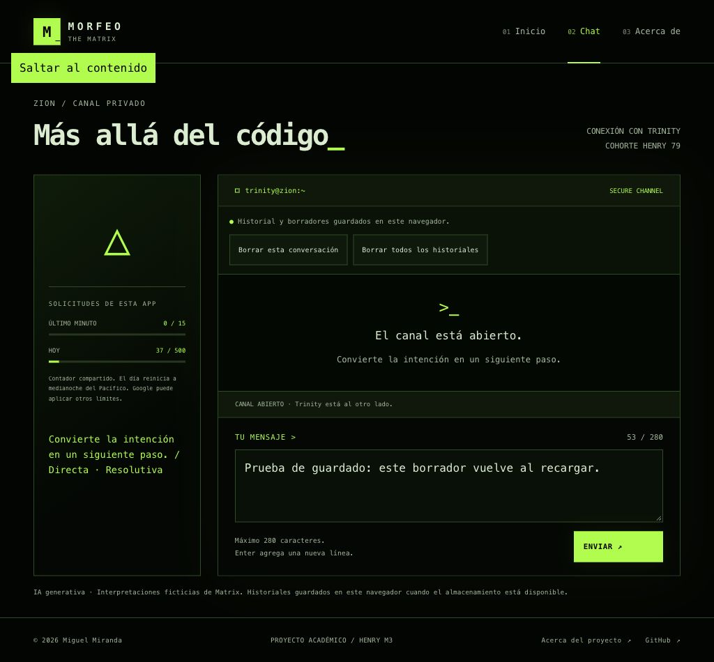
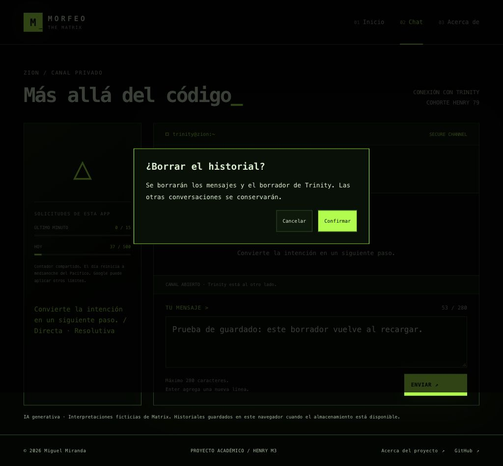

# Historiales guardados en el navegador

Guardo las conversaciones y borradores separados de Morfeo, el Oráculo y Trinity mediante `src/history-storage.js`. La vista muestra si los cambios están guardados, si se recuperó un borrador o si hay un problema que requiere atención.

## Dónde y qué se guarda

El controlador de conversaciones usa la clave **`morfeo.conversations.v1`** de localStorage. El [ciclo de Smith](smith.md) usa una clave independiente y no se elimina al borrar conversaciones. Contiene una versión de formato, el personaje activo y tres entradas con `messages`, `draft` e `interrupted`. No guarda credenciales, cookies, prompts ni cuotas. Los errores transitorios de la interfaz tampoco se serializan.

El almacenamiento pertenece al **origen**: protocolo, dominio y puerto. Se conserva entre sesiones del mismo navegador; cambiar de dispositivo, perfil, puerto o dominio de Preview no traslada los datos. Para revisar la iteración de forma continua uso su [URL estable de rama](https://chat-morfeo-m3-git-feat-matrix-v2-miguel-miranda-v.vercel.app/home). La URL de producción tiene su propio almacenamiento. [Referencia: localStorage](https://developer.mozilla.org/en-US/docs/Web/API/Window/localStorage).

Los datos se guardan como texto, sin cifrado propio. El código compartido 79 abre el canal de la app y no representa una cuenta personal. La vista de mensajes y el campo del borrador se mantienen vacíos hasta validar acceso. El navegador puede eliminar o bloquear datos según sus ajustes.

## Guardado y restauración

El controlador se suscribe al estado de conversaciones, separado del montaje de Chat. Guarda cambios de mensajes, borradores y selección cuando hay contenido; evita escrituras idénticas. Si todo está vacío, elimina la clave propia. Navegar entre vistas no retira este controlador.

Al cargar valida JSON, versión, claves exactas, personajes permitidos, alternancia de turnos completos, tipos de datos y longitud de mensajes del usuario. Conserva el texto íntegro, incluido HTML como texto, espacios y grafemas. Un borrador pegado con más de 280 caracteres se conserva para corregirlo, aunque no se pueda enviar.

El formato tiene un máximo de **1 MiB medido en UTF-8** y 4096 mensajes por personaje. Es un límite de la app, independiente de la cuota de almacenamiento del navegador. No sustituye el límite de **64 KiB de la petición al backend**. Si no puede guardar todo, conserva la conversación en memoria e informa el fallo; no trunca mensajes.

Un registro dañado o de otra versión no se sobreescribe automáticamente. La conversación puede continuar en memoria. La opción de borrar todos los historiales permite descartar expresamente ese registro y reactivar el guardado.

## Envíos interrumpidos

Antes de esperar a la API, el controlador guarda los turnos completos anteriores y el mensaje pendiente como borrador, con marca de interrupción. No persiste un turno user suelto como conversación completa.

Al recargar restaura ese borrador con un aviso y **no lo reenvía**. También conserva la marca cuando fetch termina en error de red o timeout al cerrarse la página. Al recibir una respuesta completa se guarda el par user/assistant. El controlador se retira al cerrar una página que no entrará en la caché de navegación, para que una respuesta tardía no sobrescriba datos nuevos.

Recuperar el borrador no recupera una respuesta del servidor que nunca llegó al navegador. Una reserva de cuota ya realizada puede seguir consumida; el usuario decide si reintenta.

## Borrado con confirmación

- **Borrar esta conversación:** elimina mensajes y borrador del personaje activo; conserva las otras conversaciones y la selección.
- **Borrar todos los historiales:** elimina la clave de conversaciones y vuelve a la selección inicial, salvo que Smith controle la terminal: en ese caso conserva su intervención y personaje de retorno.
- Ambas acciones muestran un diálogo con alcance explícito y Cancelar como foco inicial. Escape cancela. [Referencia del diálogo modal](https://developer.mozilla.org/en-US/docs/Web/API/HTMLDialogElement/showModal).
- Se bloquean durante una respuesta pendiente. Primero se comprueba el cambio de almacenamiento y después se limpia la memoria. Si el navegador rechaza el cambio, se informa y la conversación permanece disponible.
- No uso `localStorage.clear()`. Las claves ajenas y las cuotas Redis se conservan.

## Cambios desde otra pestaña

Un evento `storage`, o una comprobación al volver a la pestaña, detecta cambios en nuestra clave. También comparo el valor antes de escribir, por si el evento todavía no llegó. [Referencia del evento storage](https://developer.mozilla.org/en-US/docs/Web/API/Window/storage_event).

Al detectar un cambio pauso el guardado automático. La memoria local se conserva y se ofrecen dos decisiones con confirmación: **Cargar historial guardado** o **Conservar esta pestaña**. No reemplazo mensajes ni borradores mientras hay una respuesta pendiente. Al cargar otra versión se incrementa una revisión para reconstruir el log aunque la cantidad de mensajes sea igual.

Esta coordinación detecta cambios y evita sobrescrituras automáticas conocidas; localStorage no es una base transaccional entre usuarios. La elección de conservar una versión reemplaza la otra y no combina conversaciones divergentes.

## Evidencia de la etapa de persistencia

- En esa etapa pasaron **188 tests**, incluidos 36 casos de persistencia con almacenamiento sustituido.
- Navegador con frontend real y backend de QA identificado: recarga restaura un turno y borrador; interrumpir un envío restaura el borrador sin generar otro.
- El diálogo de borrado se abrió y canceló sin cambios. El borrado efectivo, alcance, claves ajenas y fallos se verificaron en tests; no se borraron conversaciones del usuario para probarlo.
- Dos pestañas compartiendo el origen de QA muestran el conflicto y el diálogo de elección. Cancelar mantiene el estado local.
- Al bloquear localStorage, el chat sigue funcionando en memoria y el indicador informa el fallo. Un registro corrupto se conserva sin escribir encima.
- Un historial ficticio preparado para la prueba queda fuera del log y el borrador antes del acceso; aparece al introducir 79.
- Los escenarios de respuestas/interrupción fueron simulados y no se presentan como respuestas Gemini. **0 generaciones Gemini** en esta etapa.

