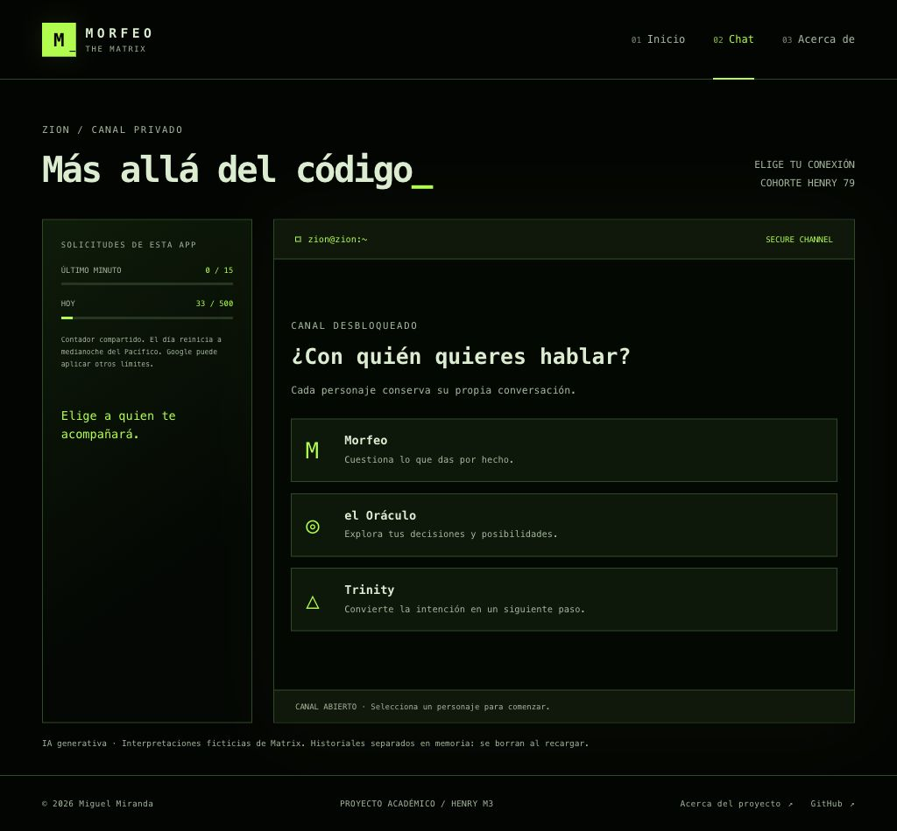
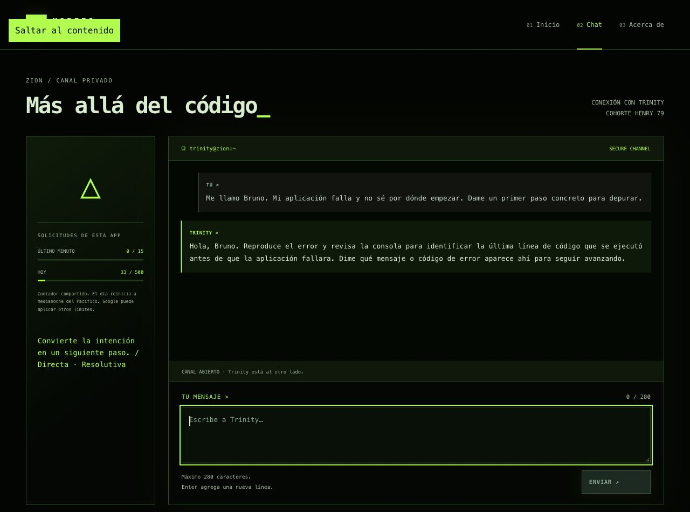

# Personajes, contrato y conversaciones

En la iteración 2 incorporé tres interpretaciones ficticias de Matrix. Cada una usa un prompt distinto, definido en `api/functions.js`. `src/characters.js` contiene únicamente identificadores y metadatos públicos para la interfaz.

| Identificador | Personaje | Orientación de su voz |
| --- | --- | --- |
| `morpheus` | Morfeo | Reflexivo, sereno y firme; ayuda a cuestionar y comprender. |
| `oracle` | El Oráculo | Cálida y perspicaz; explora decisiones sin afirmar que conoce el futuro real. |
| `trinity` | Trinity | Directa y resolutiva; propone pasos concretos sin fingir que ha ejecutado acciones. |

Comparten reglas de brevedad, atención al contexto, respuestas originales y distinción entre ficción y realidad. Los mensajes del usuario no sustituyen la configuración del servidor. El texto del modelo tampoco ejecuta un cambio de personaje en la aplicación.

## Recorrido actual

1. El backend valida el acceso mediante el código **79** y la cookie firmada.
2. La terminal muestra **¿Con quién quieres hablar?**. No envía preguntas antes de elegir un destinatario.
3. Al elegir, adapta nombre del canal, autor, texto de espera y campo de escritura. El Oráculo y Trinity muestran emblemas, sin reutilizar el retrato de Morfeo.
4. Envía el historial de ese personaje y recibe su respuesta.

La selección inicial es funcional; el diseño completo de terminal, cambio solicitado dentro de la conversación y tarjetas de Acerca de se completarán en su etapa. Los mensajes aún viven en memoria: navegar los conserva, recargar los borra. La persistencia con localStorage es el paso siguiente.

## Contrato de generación

Petición, después de autenticar:

```json
{
  "character": "trinity",
  "messages": [
    { "role": "user", "content": "¿Por dónde empiezo a depurar?" }
  ]
}
```

Respuesta:

```json
{
  "character": "trinity",
  "reply": "Una respuesta generada por el modelo.",
  "quota": { "minuteUsed": 1, "minuteLimit": 15, "dayUsed": 1, "dayLimit": 500 }
}
```

El ejemplo de respuesta ilustra la forma del contrato; su texto no se presenta como una generación real. `quota` incluye además los tiempos y estados del contrato de cuotas existente.

El servidor admite exactamente `character` y `messages` para generar, valida los tres identificadores y rechaza claves como `systemPrompt`. El historial alterna `user/assistant`, termina en `user` y conserva el límite de 280 grafemas por mensaje del usuario y 64 KiB por petición completa. El prompt se añade como `systemInstruction`, separado de esos turnos.

Un personaje inválido produce `400 INVALID_CHARACTER` antes de reservar cuota o llamar a Gemini. Un contrato sin personaje se rechaza; no se elige uno silenciosamente. Las operaciones `{action:"session"}` y `{action:"unlock",cohort:"79"}` conservan su contrato.

El cliente comprueba que la respuesta esté etiquetada para el personaje solicitado. Si no coincide, recupera el borrador y no agrega la respuesta. La etiqueta controla coherencia del protocolo; no es una firma criptográfica del contenido.

## Estado separado

`createCharacterSession` coordina un Map con tres sesiones `createChatSession`. Cada una guarda:

- Su identificador y mensajes.
- Su borrador.
- Su estado de envío y error recuperable.

La selección cambia la conversación activa sin copiar mensajes entre personajes. Durante una respuesta pendiente se bloquean otro envío y un cambio de selección. La función que envía conserva su destinatario; una respuesta nunca se agrega a la sesión elegida después por accidente. Los snapshots son copias, para que la interfaz y los suscriptores no puedan modificar mensajes internos.

La separación es del estado cliente. El backend recibe y valida el historial enviado, sin almacenarlo ni demostrar su procedencia. Redis sigue guardando únicamente cantidades y tiempos; los tres personajes comparten **15 reservas por 60 segundos móviles y 500 por día del Pacífico**.

## Verificación

- **152 tests** pasan; 22 nuevos cubren riesgos de identidad, contrato, separación, concurrencia y errores. El test de cuotas alterna los tres personajes y rechaza la reserva 16.
- Se probaron tres respuestas reales por la interfaz local, una por personaje, usando preguntas y nombres ficticios. Las tres terminaron correctamente; las reservas diarias compartidas pasaron de **30 a 33**.
- Morfeo explicó cómo expresar la lógica en lenguaje sencillo al atascarse con JavaScript. El Oráculo comparó concentración y debate al elegir cómo estudiar. Trinity propuso reproducir el error y revisar la consola.
- Esta muestra comprueba integración y ofrece una primera observación de voz. No reemplaza la evaluación más amplia de la etapa de pruebas.
- Hubo un fallo transitorio al consultar disponibilidad al entrar; el reintento de desbloqueo funcionó y permitió continuar con Redis real.
- La selección se revisó en 320 y 1024 px sin desbordamiento horizontal. Personaje y borrador se conservaron al navegar Chat → Acerca de → Chat.




