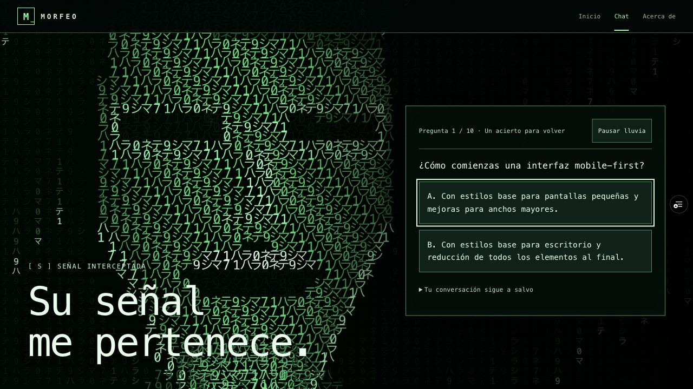
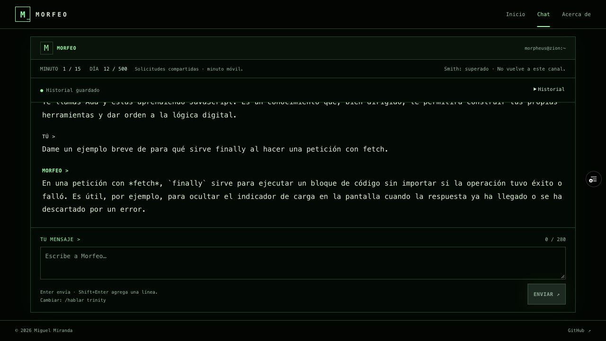

# Publicación de la iteración 3

## Preview para revisión

- **Preview:** [Matrix v3](https://chat-morfeo-m3-git-feat-matrix-v3-miguel-miranda-v.vercel.app/home).
- **Código de acceso:** **79**.
- **Pull request:** [#2](https://github.com/MiguelMirandaV/chat-morfeo-m3/pull/2), `feat/matrix-v3` → `main`.
- **Commit comprobado:** `f6e63e31f144273833c72181f05b239871b9175a`. Los commits posteriores de documentación conservan exactamente su código funcional.
- **Vercel:** [despliegue terminado](https://vercel.com/miguel-miranda-v/chat-morfeo-m3/6pzzMdALd5H6xaRRpvVe4skhMmPj); GitHub notificó SUCCESS para ese SHA el 28 de octubre de 2026, 20:44 UTC.

El dominio de Preview conserva la protección de Vercel existente. Lo comprobé en el navegador con una sesión autorizada; fuera de esa sesión, las peticiones HTTP anónimas redirigen al login de Vercel. Esto ocurre antes del código **79** de la aplicación. Para revisarlo, inicio sesión con mi cuenta Vercel si aparece esa pantalla. No modifiqué la protección ni regeneré credenciales.

## Comprobación real en navegador

El 28 de octubre de 2026 comprobé Inicio y Acerca de, su navegación SPA y la recarga directa de Chat y Acerca de. **78** fue rechazado y **79** abrió el selector de personajes.

Con Morfeo realicé **tres generaciones reales** con datos ficticios. En el primer mensaje indiqué el nombre Ada y el lenguaje JavaScript; la segunda respuesta recordó ambos. El tercer mensaje preguntó por finally al usar fetch. Cada respuesta incrementó el progreso del personaje y, tras la tercera, Smith tomó la pantalla.

Fallé la primera pregunta: apareció la segunda. Recargué y la pregunta 2 permaneció pendiente. Acerté y recuperé los seis mensajes y el campo de entrada. Una nueva recarga conservó el historial y el indicador «Smith: superado · No vuelve a este canal». La consola revisada no mostró errores ni avisos.

El contador diario pasó de **9 a 12**. Las opciones del cuestionario y las recargas no aumentaron ese contador. No provoqué agotamiento de cuota ni repetí la evaluación de las tres voces: los prompts y el servidor no cambiaron.

## Pruebas y límites

- **275 pruebas en ocho archivos**, build y diff aprobados antes de subir.
- El [informe local](verificacion-iteracion-3.md) cubre diez errores cíclicos, independencia entre personajes, borrado, migración, conflictos, errores y viewports CSS embebidos. Esos casos usan mocks y no se atribuyen al recorrido real anterior.
- La revisión de Preview fue de escritorio; no constituye una prueba física en móvil ni una certificación de todos los navegadores.
- Las comprobaciones HTTP anónimas fueron interceptadas por el login de Vercel: no las cuento como pruebas satisfactorias de hashes, rutas ni exclusión de archivos privados. La correspondencia del despliegue se respalda en el estado Vercel asociado al SHA de GitHub y en el recorrido del navegador.
- Esta iteración no cambia dependencias, función de servidor ni credenciales.

## Production

La revisión de Miguel está pendiente. No integré la pull request ni publiqué esta iteración en Production. El [dominio público](https://chat-morfeo-m3.vercel.app/home) conserva la [iteración 2](publicacion-iteracion-2.md). Después de aprobar el Preview integraré el cambio y comprobaré el dominio público por separado.
