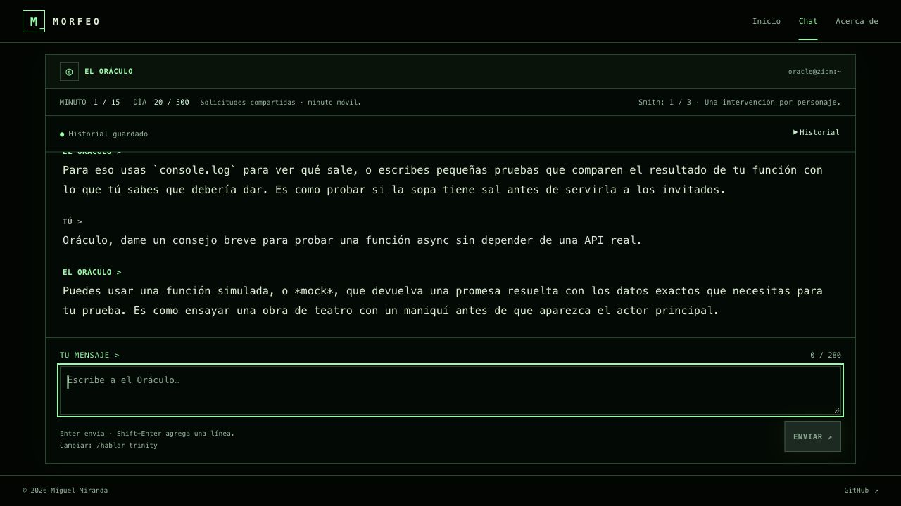

# Publicación de la iteración 3

## Preview revisado

- **Preview:** [Matrix v3](https://chat-morfeo-m3-git-feat-matrix-v3-miguel-miranda-v.vercel.app/home).
- **Código de acceso:** **79**.
- **Pull request:** [#2](https://github.com/MiguelMirandaV/chat-morfeo-m3/pull/2), `feat/matrix-v3` → `main`.
- **Commit comprobado:** `f6e63e31f144273833c72181f05b239871b9175a`. Los commits posteriores de documentación conservan exactamente su código funcional.
- **Vercel:** [despliegue terminado](https://vercel.com/miguel-miranda-v/chat-morfeo-m3/6pzzMdALd5H6xaRRpvVe4skhMmPj); GitHub notificó SUCCESS para ese SHA el 28 de octubre de 2026, 20:44 UTC.

El dominio de Preview conserva la protección de Vercel existente. Lo comprobé en el navegador con una sesión autorizada; fuera de esa sesión, las peticiones HTTP anónimas redirigen al login de Vercel. Esto ocurre antes del código **79** de la aplicación. Para revisarlo, inicio sesión con mi cuenta Vercel si aparece esa pantalla. No modifiqué la protección ni regeneré credenciales.

## Comprobación real en navegador

El 28 de octubre de 2026 comprobé Inicio y Acerca de, su navegación SPA y la recarga directa de Chat y Acerca de. **78** fue rechazado y **79** abrió el selector de personajes.

Con Morfeo realicé **tres generaciones reales** con datos ficticios. En el primer mensaje indiqué el nombre Ada y el lenguaje JavaScript; la segunda respuesta recordó ambos. El tercer mensaje preguntó por finally al usar fetch. Cada respuesta incrementó el progreso del personaje y, tras la tercera, Smith tomó la pantalla.

Fallé la primera pregunta: apareció la segunda. Recargué y la pregunta 2 permaneció pendiente. Acerté y recuperé los seis mensajes y el campo de entrada. Una nueva recarga conservó el historial y el indicador «Smith: superado · No vuelve a este canal». La consola revisada no mostró errores ni avisos.

El contador diario pasó de **9 a 12**. Las opciones del cuestionario y las recargas no aumentaron ese contador. No provoqué agotamiento de cuota ni repetí la evaluación de las tres voces: los prompts y el servidor no cambiaron.

## Pruebas y límites

- **275 pruebas en ocho archivos**, build y diff aprobados antes de subir.
- El [informe local](verificacion-iteracion-3.md) cubre diez errores cíclicos, independencia entre personajes, borrado, migración, conflictos, errores y viewports CSS embebidos. Esos casos usan mocks y no se atribuyen al recorrido real anterior.
- La revisión de Preview fue de escritorio; no constituye una prueba física en móvil ni una certificación de todos los navegadores.
- Las comprobaciones HTTP anónimas fueron interceptadas por el login de Vercel: no las cuento como pruebas satisfactorias de hashes, rutas ni exclusión de archivos privados. La correspondencia del despliegue se respalda en el estado Vercel asociado al SHA de GitHub y en el recorrido del navegador.
- Esta iteración no cambia dependencias, función de servidor ni credenciales.

## Production comprobada

Completé la revisión de Preview y continué con la integración dentro del flujo acordado. La [pull request #2](https://github.com/MiguelMirandaV/chat-morfeo-m3/pull/2) quedó integrada el **28 de octubre de 2026, 20:54 UTC**.

- **Aplicación pública:** [chat-morfeo-m3.vercel.app](https://chat-morfeo-m3.vercel.app/home), código **79**, sin login de Vercel.
- **Commit de integración:** `7036cb2b533f366cd085837731ad5e050ec2e501`.
- **Vercel:** [despliegue de producción completado](https://vercel.com/miguel-miranda-v/chat-morfeo-m3/8yMr9B5EXveiRUB9U8MSrNUyfMkT), estado SUCCESS asociado a ese SHA.
- Los commits de cierre posteriores actualizan únicamente documentación y capturas; conservan el código funcional comprobado.

Comprobé **16 resultados HTTP**, sin sesión Vercel: las tres rutas SPA entregan el index esperado; seis archivos públicos coinciden byte por byte con el código local; `.env`, `package.json` y `docs/uso-ia.md` devuelven 404; la sesión anónima está cerrada, 78 se rechaza, 79 abre el acceso y la sesión autenticada se recupera. La cookie incluye HttpOnly, Secure y SameSite=Strict. No guardé su valor. [Resultados y SHA-256](capturas/iteracion-3/produccion-http.json).

En el navegador público conservé los seis mensajes anteriores de la conversación ficticia de Lucía con el Oráculo. El contador nuevo comenzó en cero, como requiere la migración. Envié **una nueva pregunta real** sobre probar funciones async sin API externa; el Oráculo respondió con una explicación de mocks. El contador de Smith avanzó de 0 a 1 y el diario de **19 a 20**. No hubo errores ni avisos de consola observados.

El recorrido público comprueba publicación, acceso, conservación del historial y respuesta real; el ciclo completo de Smith se verificó en Preview, cuyo código funcional coincide. No repetí tres generaciones en producción ni las pruebas de todos los casos límite. El alcance de los tests locales, tamaños embebidos y limitaciones sigue indicado arriba.

La iteración queda publicada. La [iteración 2](publicacion-iteracion-2.md) conserva sus evidencias históricas.
