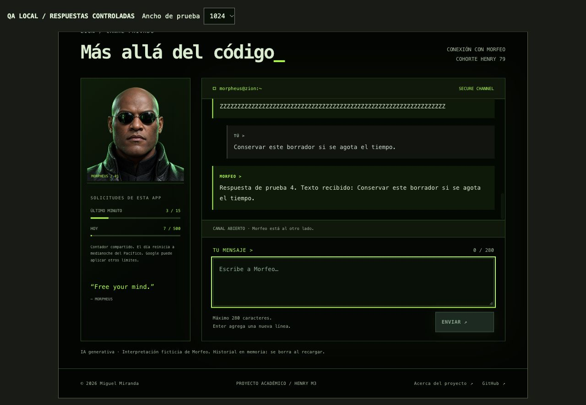

# Paso 10 — Revisión UX y casos borde

> Registro histórico de la primera entrega, identificada por `m3-v1-entregado`. Sus cifras y capturas no certifican la iteración actual. Consulta [verificacion-iteracion-2.md](verificacion-iteracion-2.md) para la información vigente.

27 de octubre de 2026. Frontend real, servidor QA separado con proveedor y cuotas controlados. Cero solicitudes reales a Gemini o Redis durante esta revisión. Las pruebas reales de integración siguen documentadas en el paso 8.

## Correcciones

1. **Foco del portal:** el control “Omitir transición” recibe foco. El fondo queda `inert` mientras aparece el diálogo; Tab permanece en el control y Escape lo cierra. La limpieza restaura el fondo antes de navegar.
2. **Sesión vencida:** un 401 muestra la explicación junto al acceso y lleva el foco a la cohorte. Al volver a introducir 79 se conserva el borrador y se limpia el error de acceso anterior.
3. **Historial con teclado:** `tabindex="0"` permite enfocar el log y desplazarlo con PageUp. El rollback elimina únicamente el mensaje fallido, evitando reconstruir los turnos anteriores.
4. **Actualizaciones del estado:** contador, botón y textos relacionados se escriben solo cuando cambian. Se evita repetir mutaciones idénticas de zonas anunciables cada segundo.

## Evidencia

[Resultados estructurados](capturas/paso-10-casos.json): 20 comprobaciones registradas y 12 combinaciones de tamaño/vista. Los tamaños 320, 600, 768 y 1024 corresponden al viewport real del documento dentro de un iframe de QA, no a una emulación de un teléfono. En Home, Chat y Acerca de, `clientWidth` coincidió con `scrollWidth`. La medición inicial se hizo antes de los cambios de foco; después se repitió Chat a320 con texto largo y a1024. El CSS no cambió.

| Recorrido | Resultado |
| --- | --- |
| Cohorte incorrecta / correcta | Error visible; foco en cohorte / compositor. |
| Espacios,280 y281 caracteres | Vacío bloqueado;280 admitidos;281 bloqueados, sin truncar. Enter agrega línea. |
| Texto con etiquetas | Se muestra literalmente; no crea nodos HTML de usuario. |
| 401 y reapertura | Historial y borrador conservados; foco y estado recuperados. |
| 503 y desconexión | Rollback del turno fallido, borrador recuperado y reintento habilitado. |
| Respuesta lenta + doble clic | Un solo POST de mensaje; indicador visible y campo de solo lectura. |
| Navegar durante la respuesta | Al volver aparece el resultado terminado fuera de Chat. |
| Respuesta de900 caracteres sin espacios | Sin overflow horizontal a320; scroll interno acotado y posicionado al final. PageUp disminuyó scrollTop con foco en el log. |
| Tiempo de espera de20s | Mensaje explicativo, borrador recuperado y campo editable. |
| 429 / Smith | Borrador conservado; bloqueo temporal y cuenta atrás; reintento explícito correcto al liberarse. |
| Pausa de lluvia | Control cambia a Reanudar, aria-pressed=true y clase is-paused. |
| Recarga | Conversación y borrador vacíos; acceso por cookie permanece. |

[Acceso vencido a320](capturas/paso-10-acceso-vencido-320.jpg) · [Smith a320](capturas/paso-10-smith-320.jpg).

## Cómo reproducir las correcciones

1. Ejecuta `npm start` en la carpeta del repositorio y abre la dirección que muestra la terminal: normalmente `http://127.0.0.1:3000/home`.
2. Introduce79. Entra al chat y usa Tab/Escape durante el portal. Comprueba el foco visible.
3. Envía una pregunta, navega a Acerca de y vuelve. El historial permanece.
4. Con un historial suficientemente largo, usa Tab hasta el log y PageUp/PageDown.
5. Pega281 caracteres: el campo conserva todo el contenido y bloquea Enviar. Corrige a280 para habilitarlo.
6. Ejecuta `npm test`:130 pruebas en tres archivos. No provoca consumo externo.

Los escenarios 401/503/429/timeout se inyectaron fuera del repositorio para evitar alterar credenciales o gastar solicitudes. No se dejó un interruptor de simulación en la app ni en la función publicada. No conviene provocar los límites reales para repetirlos manualmente.

## Límites de esta revisión

No se cambió la preferencia de movimiento del sistema ni se certificó con un lector de pantalla real. Se inspeccionaron las reglas CSS/JS de movimiento reducido y la semántica de estados; eso no equivale a una auditoría de accesibilidad completa. El registro del navegador incluyó dos errores de MutationObserver sin URL; el código de la app no utiliza MutationObserver (la lluvia utiliza ResizeObserver), y no se atribuyen esos mensajes a una causa confirmada. No impidieron los recorridos registrados.

La navegación Atrás/Adelante ya se verificó en el paso4 y tiene tests de router; esta revisión añadió navegación durante respuestas. No se afirma haber probado todos los navegadores ni HTTPS público. La publicación corresponde al paso12.
