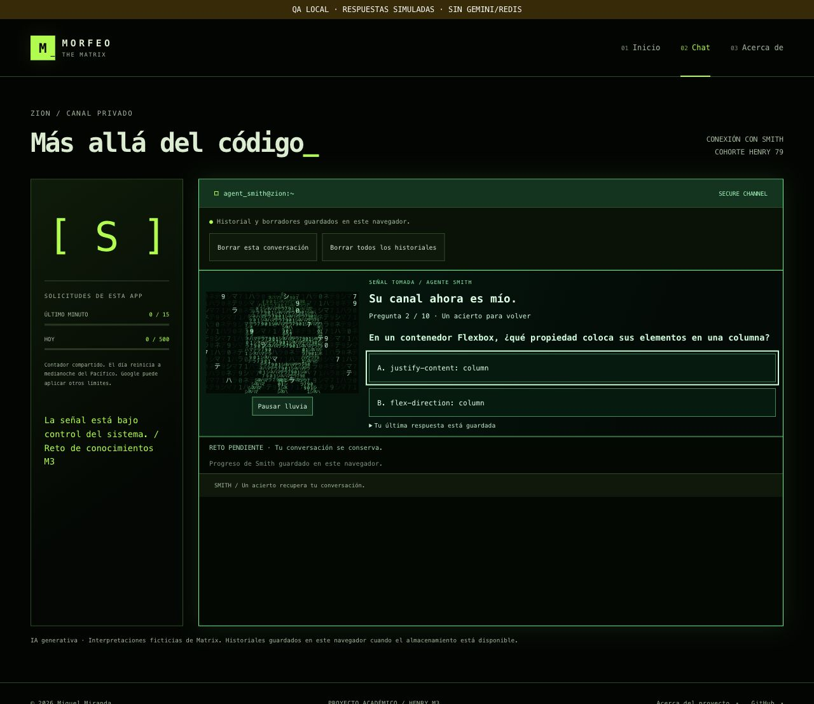

# Verificación — Iteración 3

## Cuestionario y progreso por personaje

La implementación del paso 3 se comprobó en la rama `feat/matrix-v3`. Esta evidencia no corresponde a un despliegue de producción ni al cierre de los pasos visuales.

- **270 tests en ocho archivos**, todos aprobados. La ejecución bloquea la red salvo mocks explícitos.
- **Build aprobado:** módulos y licencia de Three.js preparados con el script del proyecto.
- **78 casos de Smith y controles:** progreso por personaje, un único reto, errores que no cuentan, diez preguntas cíclicas, acierto, rechazo de respuestas duplicadas, conservación del contexto, migración, recarga, borrado y conflictos.
- **Frontend real con API local simulada:** tercer intercambio → pregunta 1 → error → pregunta 2 → recarga → acierto → conversación original → recarga → siguiente envío con Enter.
- **Cero generaciones Gemini y cero operaciones Redis reales.** El servidor de QA recibió únicamente dos peticiones de generación simulada: la que completó el tercer intercambio y el envío posterior al reto. Las respuestas al cuestionario no llegaron al endpoint.
- **Consola sin errores ni avisos** durante ese recorrido. El foco al recuperar el reto después de validar acceso se corrigió y se volvió a comprobar.

El banco de diez preguntas está en [preguntas de Smith](preguntas-smith.md); las reglas, el formato y sus límites están en [Smith](smith.md).

## Evidencia y límites

[Registro del recorrido y huellas de código](capturas/iteracion-3/cuestionario-local.json).

La captura ilustra la integración funcional del cuestionario con la presentación anterior. En ese paso todavía no se habían completado la simplificación de terminal ni la escena ampliada; sus comprobaciones aparecen más abajo. No se presenta esta imagen como la interfaz final ni como una prueba móvil.

Los casos de migración y borrado utilizaron almacenamiento ficticio en Vitest; no se borraron conversaciones del usuario. La coordinación de localStorage detecta conflictos conocidos y no ofrece transacciones entre pestañas. No se consumió cuota real para comprobar errores o el cuestionario.

## Terminal simplificada

El paso 4 mantiene las **270 pruebas en ocho archivos** y el build aprobados. Cambia la presentación y los controles de historial, conservando la lógica del cuestionario y los contratos de servidor.

- Terminal de una columna, emblemas para todos los personajes y ausencia de fotografías en Chat.
- Contadores de solicitudes, progreso de Smith y caracteres; los estados normales redundantes quedan ocultos y los avisos accionables permanecen.
- Historial en un desplegable con Escape, confirmación de borrado y recuperación del foco al cancelar.
- Fallo de respuesta simulado, borrador conservado, reintento y cambio confirmado a Trinity.
- Cuota agotada y localStorage bloqueado comprobados mediante escenarios locales; ningún servicio remoto fue utilizado.
- Escritorio de 1280 px y viewports CSS embebidos de 320 y 768 px sin overflow horizontal. A 320 px, el botón Enviar de 44 px queda dentro del área visible. La herramienta no aplicó el ajuste directo de viewport; los tamaños se midieron en los marcos. No es una prueba con teclado físico móvil.

[Registro y límites de QA](capturas/iteracion-3/terminal-local.json).

[Captura de los viewports embebidos](capturas/iteracion-3/terminal-responsive.png). La escena ampliada se comprueba en el apartado siguiente.

## Toma de pantalla de Smith

El paso 5 cierra con **275 pruebas en ocho archivos** y build aprobado. Los **nueve casos de escena** cubren píxeles y glifos acotados en pantallas enormes, intervalo de dibujo, pausa, movimiento reducido, cero dibujo oculto, desmontaje idempotente, callbacks tardíos y fallback de Canvas.

En navegador comprobé:

- Escena de 1280 × 720 que cubre exactamente el viewport, con navegación por encima y opciones legibles.
- Pausa, error y avance de pregunta; salida a Acerca de con la clase global retirada y vuelta a la pregunta pendiente.
- Aviso y acciones de conflicto accesibles dentro de Smith. Abrir y cancelar el diálogo conserva los datos y devuelve foco al cuestionario.
- Acierto que retira la escena y recupera seis mensajes y el campo de entrada.
- Viewports CSS embebidos de 320 × 640 y 768 × 820 sin desbordamiento horizontal. En 320 px, ambas opciones de la pregunta inicial quedan dentro del panel; el contenido adicional puede desplazarse.
- Movimiento reducido simulado con imagen estática; fallo de Canvas simulado con cuestionario resoluble. No se cambió la configuración del sistema.

**Cero generaciones Gemini y cero operaciones Redis reales.** No hubo errores ni avisos de consola en el recorrido directo y en el fallback comprobados. No se afirma una prueba física de móvil o lector de pantalla ni un benchmark gráfico.

[Registro, dimensiones y huellas de código](capturas/iteracion-3/smith-escena-local.json).

[Vista móvil y tablet con movimiento reducido simulado](capturas/iteracion-3/smith-responsive.png). La comprobación remota de esta implementación se registra por separado en [Preview y publicación](publicacion-iteracion-3.md); la revisión de Preview está completada y las comprobaciones de Production tienen su propio registro.
